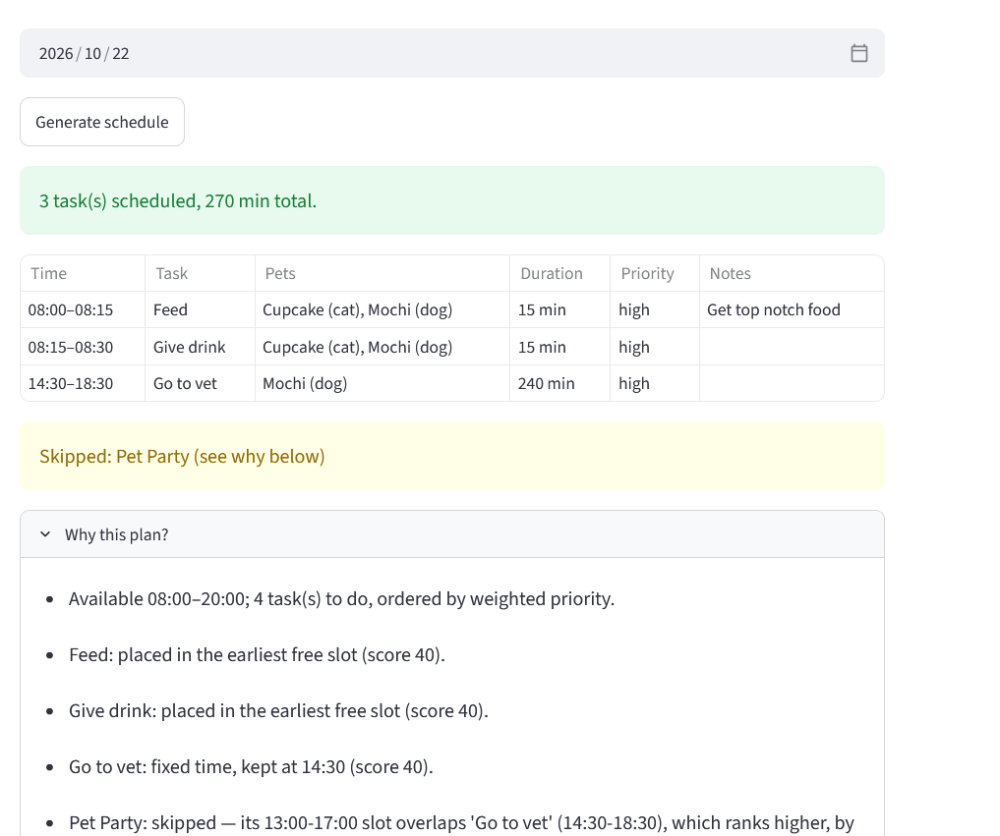
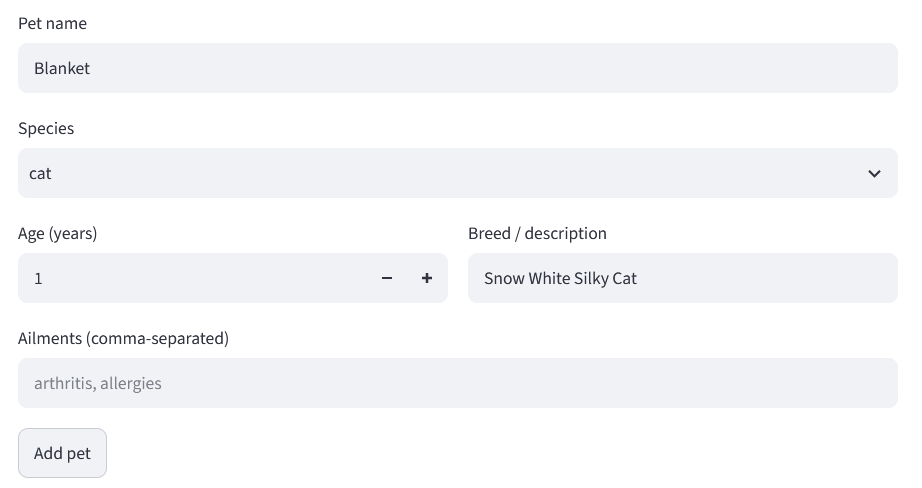
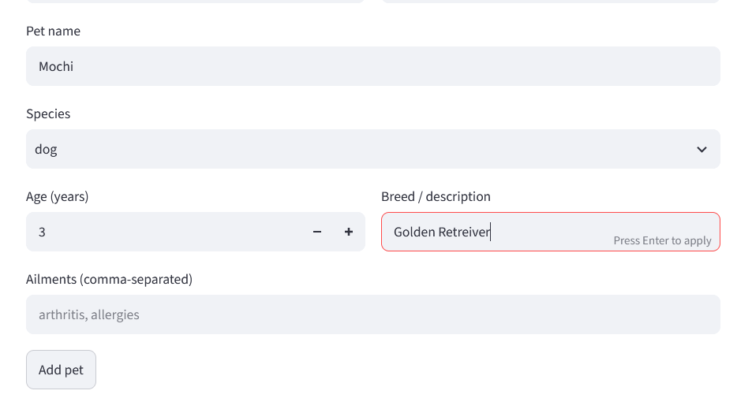
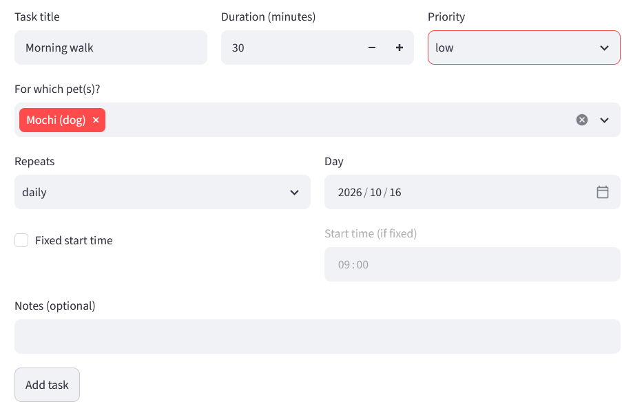
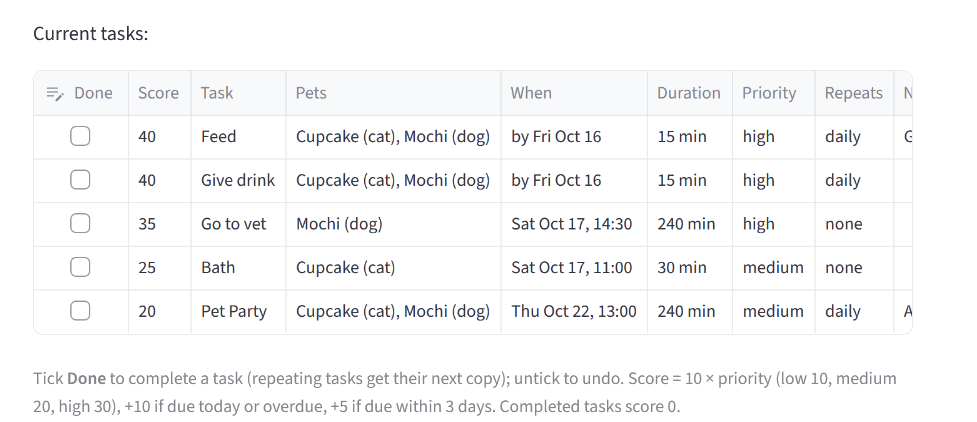
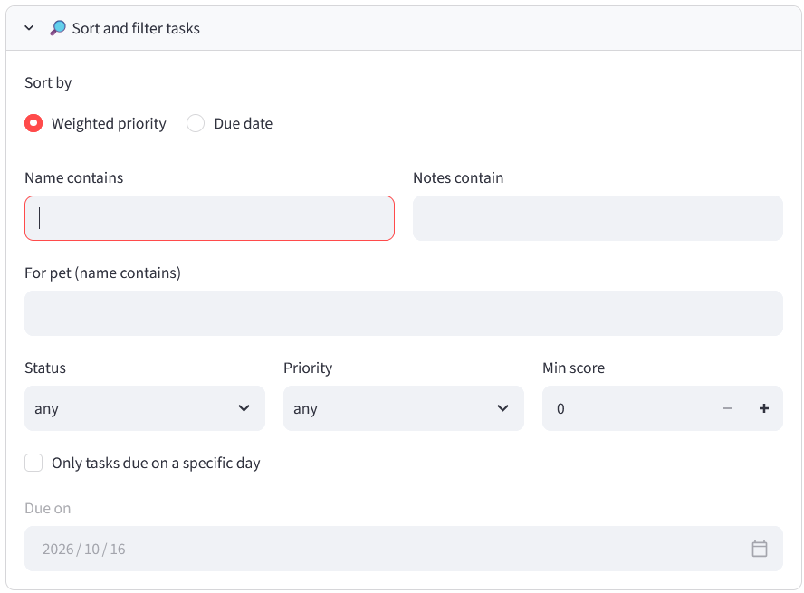
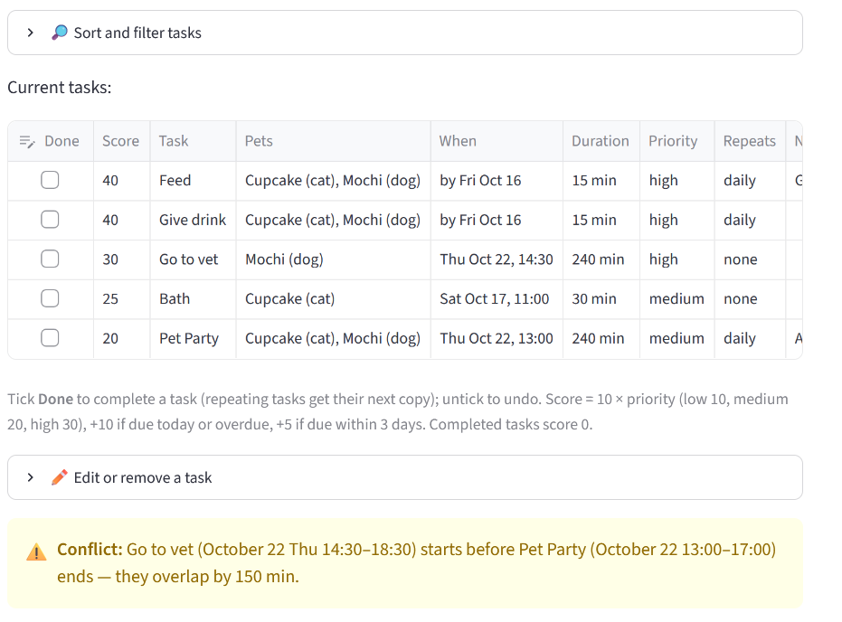
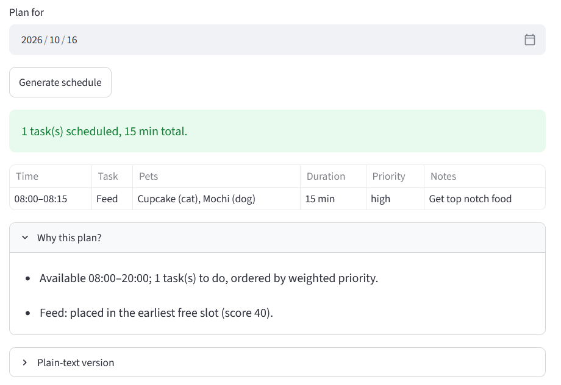
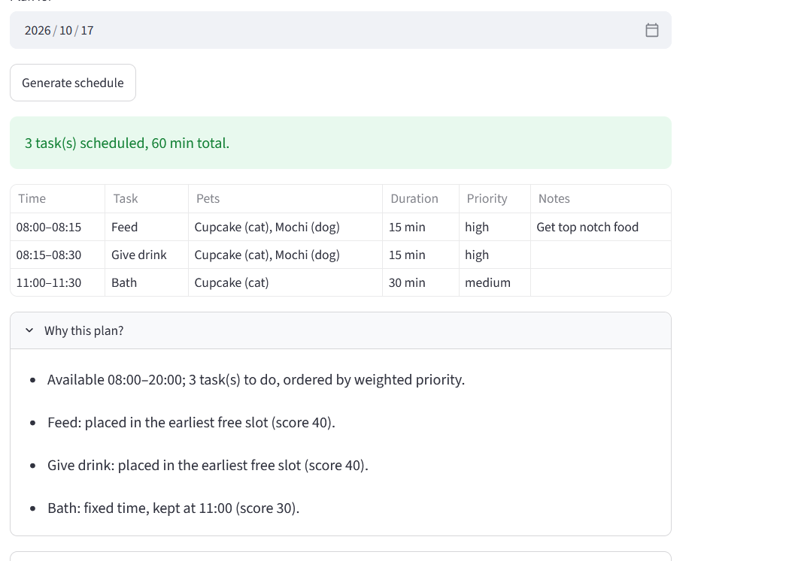
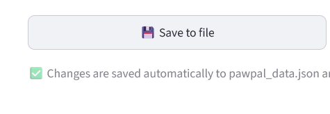

# PawPal+ (Module 2 Project)

You are building **PawPal+**, a Streamlit app that helps a pet owner plan care tasks for their pet.

## Implementation Summary

I built **PawPal+**, an app where an owner adds care tasks to each of their pets (for example, a morning walk for Sally the poodle and feeding Stacy the parrot) and gets a daily plan that explains its choices.

**How the classes work together:**

- **Task**: one care activity: name, duration, priority, optional due date and fixed start time, completion status, and how often it repeats (daily, weekly, monthly).
- **Pet**: a pet's details (name, type, age, ailments) and its list of tasks. Two pets can share the same task, like one walk for two dogs; it is stored once and scheduled once.
- **Owner**: the owner's available hours and their pets. `get_all_tasks()` gathers every pet's tasks into one list, and the owner can save and load everything as JSON.
- **Scheduler**: the "brain." It reads tasks only through the Owner, so it always works across all pets. It scores each task by **weighted priority** (higher priority, closer due date, and not yet completed means a higher score). It can sort and filter tasks, detect overlapping tasks, find the next free time slot, and create the next copy of a completed repeating task.
- **DailyPlan**: the result of `Scheduler.generate_daily_plan()`. It lists scheduled tasks in time order, skipped tasks, which pets each task is for, and the reason for every decision.

**Flow:** Owner → pets → tasks → Scheduler → DailyPlan → printed in `main.py` or shown in the Streamlit app.

## Scenario

A busy pet owner needs help staying consistent with pet care. They want an assistant that can:

- Track pet care tasks (walks, feeding, meds, enrichment, grooming, etc.)
- Consider constraints (time available, priority, owner preferences)
- Produce a daily plan and explain why it chose that plan

Your job is to design the system first (UML), then implement the logic in Python, then connect it to the Streamlit UI.

## What you will build

Your final app should:

- Let a user enter basic owner + pet info
- Let a user add/edit tasks (duration + priority at minimum)
- Generate a daily schedule/plan based on constraints and priorities
- Display the plan clearly (and ideally explain the reasoning)
- Include tests for the most important scheduling behaviors

## Getting started

### Setup

```bash
python -m venv .venv
source .venv/bin/activate  # Windows: .venv\Scripts\activate
pip install -r requirements.txt
```

### Suggested workflow

1. Read the scenario carefully and identify requirements and edge cases.
2. Draft a UML diagram (classes, attributes, methods, relationships).
3. Convert UML into Python class stubs (no logic yet).
4. Implement scheduling logic in small increments.
5. Add tests to verify key behaviors.
6. Connect your logic to the Streamlit UI in `app.py`.
7. Refine UML so it matches what you actually built.

## 🖥️ Sample Output

Paste a sample of your app's CLI or Streamlit output here so a reader can see what a generated plan looks like:

- 


## 🧪 Testing PawPal+

Run the test suite from the project folder (with the virtual environment activated):

```bash
python -m pytest
```

Add `-v` to see the name of every test. All tests use fixed dates, so they give the same result on any day.

**What the tests cover** (`tests/test_pawpal.py`, 52 tests):

- **Basics:** marking a task complete changes its status; adding a task to a pet increases its task count.
- **Sorting:** tasks added out of order come back in time order by due date (a fixed task's start time counts as its deadline); weighted-priority ties go to the earlier due date, then alphabetically.
- **Filtering:** by completion status, by pet name (partial, ignores capitals), and both combined.
- **Conflicts:** overlapping tasks of different pets are detected with the overlap in minutes (cat bath 16:15–16:45 vs. parrot feeding 16:30); tasks with the same due date or back-to-back times are *not* conflicts; the daily plan keeps the higher-ranked task and explains why the other was skipped.
- **Shared tasks:** one task for two pets is listed, scheduled, and recurred once, and never conflicts with itself.
- **Recurring tasks:** completing a daily task creates the next one for today + 1 day (weekly: + 7 days), including late tasks and month ends (Oct 31 → Nov 1); unticking takes the copy back, and repeated ticking never piles up copies.
- **Duplicates:** the same pet (name + species) or the same task at the same time can't be added twice, and an edit that would create one changes nothing.
- **Empty data:** an owner with no pets or pets with no tasks give empty results, not errors.
- **Invalid input:** wrong types (a number as a name, text as a duration, `True` as a frequency) and bad values (blank names, 0-minute tasks, start time after end time) are rejected with a clear error.

Output of a successful run:

```
configfile: pytest.ini
testpaths: tests
plugins: anyio-4.15.1
collected 52 items                                                                                                   

tests/test_pawpal.py::test_mark_complete_changes_status PASSED                                                 [  1%]
tests/test_pawpal.py::test_add_task_increases_pet_task_count PASSED                                            [  3%]
tests/test_pawpal.py::test_shared_task_belongs_to_both_pets_but_is_listed_once PASSED                          [  5%]
tests/test_pawpal.py::test_shared_task_is_not_a_conflict_and_is_scheduled_once PASSED                          [  7%]
tests/test_pawpal.py::test_overlapping_tasks_of_different_pets_are_detected PASSED                             [  9%]
tests/test_pawpal.py::test_daily_plan_keeps_higher_priority_task_when_pets_tasks_clash PASSED                  [ 11%]
tests/test_pawpal.py::test_same_due_date_with_separate_or_back_to_back_windows_is_not_a_conflict PASSED        [ 13%]
tests/test_pawpal.py::test_owner_with_no_pets_gives_empty_results_not_errors PASSED                            [ 15%]
tests/test_pawpal.py::test_pets_with_no_tasks_leave_the_whole_day_free PASSED                                  [ 17%]
tests/test_pawpal.py::test_task_with_only_a_name_is_rejected PASSED                                            [ 19%]
tests/test_pawpal.py::test_invalid_task_values_are_rejected[number as a task name] PASSED                      [ 21%]
tests/test_pawpal.py::test_invalid_task_values_are_rejected[blank name] PASSED                                 [ 23%]
tests/test_pawpal.py::test_invalid_task_values_are_rejected[non-numeric string] PASSED                         [ 25%]
tests/test_pawpal.py::test_invalid_task_values_are_rejected[numeric string is still text] PASSED               [ 26%]
tests/test_pawpal.py::test_invalid_task_values_are_rejected[a task must take some time] PASSED                 [ 28%]
tests/test_pawpal.py::test_invalid_task_values_are_rejected[bool is not a duration] PASSED                     [ 30%]
tests/test_pawpal.py::test_invalid_task_values_are_rejected[must be Priority.HIGH] PASSED                      [ 32%]
tests/test_pawpal.py::test_invalid_task_values_are_rejected[bool instead of a Frequency] PASSED                [ 34%]
tests/test_pawpal.py::test_invalid_task_values_are_rejected[bool instead of a datetime] PASSED                 [ 36%]
tests/test_pawpal.py::test_invalid_task_values_are_rejected[text instead of a datetime] PASSED                 [ 38%]
tests/test_pawpal.py::test_invalid_task_values_are_rejected[date without a time of day] PASSED                 [ 40%]
tests/test_pawpal.py::test_invalid_task_values_are_rejected[text instead of True/False] PASSED                 [ 42%]
tests/test_pawpal.py::test_invalid_pet_values_are_rejected[number as a pet name] PASSED                        [ 44%]
tests/test_pawpal.py::test_invalid_pet_values_are_rejected[empty name] PASSED                                  [ 46%]
tests/test_pawpal.py::test_invalid_pet_values_are_rejected[number as a pet type] PASSED                        [ 48%]
tests/test_pawpal.py::test_invalid_pet_values_are_rejected[non-numeric string] PASSED                          [ 50%]
tests/test_pawpal.py::test_invalid_pet_values_are_rejected[negative age] PASSED                                [ 51%]
tests/test_pawpal.py::test_invalid_pet_values_are_rejected[a single string, not a list] PASSED                 [ 53%]
tests/test_pawpal.py::test_invalid_owner_and_scheduler_values_are_rejected PASSED                              [ 55%]
tests/test_pawpal.py::test_invalid_edit_is_rejected_and_leaves_task_unchanged PASSED                           [ 57%]
tests/test_pawpal.py::test_pet_with_same_name_and_species_is_rejected PASSED                                   [ 59%]
tests/test_pawpal.py::test_same_task_name_at_the_same_time_is_rejected_but_other_times_are_allowed PASSED      [ 61%]
tests/test_pawpal.py::test_recurring_task_still_creates_next_day_copy PASSED                                   [ 63%]
tests/test_pawpal.py::test_edit_that_would_create_a_duplicate_is_rejected_and_changes_nothing PASSED           [ 65%]
tests/test_pawpal.py::test_tied_scores_are_sorted_alphabetically PASSED                                        [ 67%]
tests/test_pawpal.py::test_tied_fixed_tasks_that_clash_keep_the_alphabetically_first PASSED                    [ 69%]
tests/test_pawpal.py::test_tied_flexible_tasks_go_to_the_earlier_due_date_before_the_alphabet PASSED           [ 71%]
tests/test_pawpal.py::test_completing_daily_task_creates_one_for_today_plus_one_day PASSED                     [ 73%]
tests/test_pawpal.py::test_completing_weekly_task_creates_one_for_today_plus_seven_days PASSED                 [ 75%]
tests/test_pawpal.py::test_late_daily_task_comes_back_tomorrow_not_on_a_past_date PASSED                       [ 76%]
tests/test_pawpal.py::test_daily_task_rolls_over_the_end_of_the_month PASSED                                   [ 78%]
tests/test_pawpal.py::test_non_repeating_task_creates_nothing PASSED                                           [ 80%]
tests/test_pawpal.py::test_shared_daily_task_gets_one_next_copy_for_both_pets PASSED                           [ 82%]
tests/test_pawpal.py::test_recurring_never_leaves_two_open_copies PASSED                                       [ 84%]
tests/test_pawpal.py::test_untick_reopens_task_and_removes_the_next_copy PASSED                                [ 86%]
tests/test_pawpal.py::test_tick_untick_tick_never_piles_up_copies PASSED                                       [ 88%]
tests/test_pawpal.py::test_untick_only_takes_back_the_copy_this_task_created PASSED                            [ 90%]
tests/test_pawpal.py::test_untick_non_repeating_task_just_reopens_it PASSED                                    [ 92%]
tests/test_pawpal.py::test_filter_by_pet_name_is_partial_and_case_insensitive PASSED                           [ 94%]
tests/test_pawpal.py::test_filter_by_completion_status PASSED                                                  [ 96%]
tests/test_pawpal.py::test_filter_by_pet_name_and_completion_combined PASSED                                   [ 98%]
tests/test_pawpal.py::test_sort_by_due_date_orders_tasks_added_out_of_order PASSED                             [100%]
```

**Confidence Level: (4/5)**

All 52 tests pass, covering the core scheduling behaviors, multi-pet cases, and invalid input. One star is held back. To expedite development AI was used and made much black code. Also the Streamlit UI was only tested manually. 


## 📐 Smarter Scheduling

> Fill in once you've implemented scheduling logic.

| Feature | Method(s) | Notes |
|---------|-----------|-------|
| Task sorting |sort_by_weighted_priority | Sort by a value calculated from task  priority, duration and its completion status. |
| Task sorting |sort_by_due_date | Sort by task due date. If their is a tie, it will sorted by task weighted priority. |

| Filtering | filter_pets | Filters tasks by name, pet type, age, and ailments. |
| Filtering | filter_tasks| Filters tasks by Task name, description, completion status, priority, task due date, weighted priority task has to be at no less of, and pet name |
| Conflict handling | detect_conflict | for tasks that are not complete and have their start dates set, if a task that starts at X time and has a duration of X2 but if X time plus X2 duration is a time that is over a start date of another task, then those 2 tasks are added to a list, which is returned|
| Recurring tasks | handle_recurring_tasks | "every completed repeating task has its next occurrence created." From Claude Free version. |

## 📸 Demo Walkthrough

#### When running it please pick dates that are from present day and later and you may have to click somewhere else after inputting a value for it to update in the UI

Describe your app in numbered steps so a reader can follow along without watching a video:

1. Install dependencies
    - #### BASH/ZSH commands for macOS, Git Bash on Windows, or WSL
    ```bash
    python3 -m venv .venv
    source .venv/bin/activate
    python -m pip install --upgrade pip
    pip install -r requirements.txt
    ```

    - #### For Windows -- PowerShell
    ```bash
    python -m venv .venv
    .\.venv\Scripts\Activate.ps1
    python -m pip install --upgrade pip
    pip install -r requirements.txt
    ```
2. Run `streamlit run app.py` on a terminal and go connect to the corresponding local URL such as `http://localhost:8501`
3. Add at least a couple pets
- Add a pet 
- Add another pet 

4. Add at least 3 tasks.
    - If you check the Fixed start time check mark, the start time of the tasks will not be automatically set for this class. You will have to set it and that can result in some time conflicts reported. The Scheduler of course skips the less important task when there is a conflicting task, when setting the daily plain for the day.

    - 

    - I added more tasks include one that will will conflict with another. They are sorted by weighted priority by default

    - 

     - Users can sort by weighted priority or due date. In the sort panel that I will show you below, users can also filter by task name and pet name.

     - 


3. Under Build Schedule header, set date of the day you want to have a schedule for.

- 

- When clicking on done check mark under the list of tasks for daily reoccurring task. They will not appear in the daily plan on the first date they were schedule but will appear in daily plans the next day after that.

- 

- 

- 

4. Please click the Save to file button to ensure your progress is saved between restarting the application at the bottom of the UI. Progress is saved to `pawpal_data.json`

- 

5. `python main.py` Can also run to test some methods of this program without UI.

 - main.py output. It shows CLI output of sorting tasks by due date and weighted priority among other things.

```bash

=== Unsorted (as stored: pet by pet, not in time order) ===
  Sun Oct 18 09:00  Bath                     [to do]  Biscuit
  Fri Oct 16 09:00  Fill bowl of pure water  [to do]  Biscuit, Rex, Kiwi
  Fri Oct 16 07:00  Morning walk             [to do]  Biscuit, Rex
  Fri Oct 16 10:30  Wing trim                [to do]  Kiwi
  Fri Oct 23 18:00  Buy parrot feed          [to do]  Kiwi
  Fri Oct 16 10:00  Vet checkup              [to do]  Kiwi

=== Sorted by due date (earliest first) ===
  Fri Oct 16 07:00  Morning walk             [to do]  Biscuit, Rex
  Fri Oct 16 09:00  Fill bowl of pure water  [to do]  Biscuit, Rex, Kiwi
  Fri Oct 16 10:00  Vet checkup              [to do]  Kiwi
  Fri Oct 16 10:30  Wing trim                [to do]  Kiwi
  Sun Oct 18 09:00  Bath                     [to do]  Biscuit
  Fri Oct 23 18:00  Buy parrot feed          [to do]  Kiwi

=== Today's Schedule ===
Daily plan for 2026-10-16 (150 min scheduled):
  07:00 — Morning walk (90 min) [priority: low] — Biscuit (dog), Rex (dog)
  08:30 — Fill bowl of pure water (15 min) [priority: high] — Biscuit (dog), Rex (dog), Kiwi (parrot)
  10:00 — Vet checkup (45 min) [priority: high] — Kiwi (parrot)
Skipped:
  Wing trim (30 min) — Kiwi (parrot)
Why:
  - Available 07:00–21:00; 4 task(s) to do, ordered by weighted priority.
  - Morning walk: fixed time, kept at 07:00 (score 10).
  - Fill bowl of pure water: placed in the earliest free slot (score 40).
  - Vet checkup: fixed time, kept at 10:00 (score 30).
  - Wing trim: skipped — its 10:30-11:00 slot overlaps 'Vet checkup' (10:00-10:45), which ranks higher, by 15 min.

=== All tasks by weighted priority (across all pets) ===
    40  Fill bowl of pure water — Biscuit (dog), Rex (dog), Kiwi (parrot)
    30  Vet checkup — Kiwi (parrot)
    20  Buy parrot feed — Kiwi (parrot)
    20  Bath — Biscuit (dog)
    10  Morning walk — Biscuit (dog), Rex (dog)
    10  Wing trim — Kiwi (parrot)

=== Conflicts ===
  Vet checkup: 10:00-10:45 (45 min)
  Wing trim: 10:30-11:00 (30 min)
  -> Wing trim starts at 10:30, before Vet checkup ends at 10:45: they overlap by 15 min

=== Next available 30-minute slot after 08:00 ===
  08:30

=== Recurring tasks ===
  Completed 'Morning walk', next one created for 2026-10-17 07:00

=== Filter: completed tasks ===
  Fri Oct 16 07:00  Morning walk             [done ]  Biscuit, Rex
  Fri Oct 16 10:00  Vet checkup              [done ]  Kiwi

=== Filter: tasks still to do, sorted by due date ===
  Fri Oct 16 09:00  Fill bowl of pure water  [to do]  Biscuit, Rex, Kiwi
  Fri Oct 16 10:30  Wing trim                [to do]  Kiwi
  Sat Oct 17 07:00  Morning walk             [to do]  Biscuit, Rex
  Sun Oct 18 09:00  Bath                     [to do]  Biscuit
  Fri Oct 23 18:00  Buy parrot feed          [to do]  Kiwi

=== Filter: Kiwi's tasks ===
  Fri Oct 16 09:00  Fill bowl of pure water  [to do]  Biscuit, Rex, Kiwi
  Fri Oct 16 10:30  Wing trim                [to do]  Kiwi
  Fri Oct 23 18:00  Buy parrot feed          [to do]  Kiwi
  Fri Oct 16 10:00  Vet checkup              [done ]  Kiwi

=== Filter: Biscuit's tasks still to do ===
  Sun Oct 18 09:00  Bath                     [to do]  Biscuit
  Fri Oct 16 09:00  Fill bowl of pure water  [to do]  Biscuit, Rex, Kiwi
  Sat Oct 17 07:00  Morning walk             [to do]  Biscuit, Rex
    ```

**Screenshot or video** *(optional)*: <!-- Insert a screenshot or link to a demo video here -->
